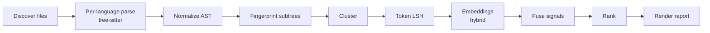

<!-- agent-pmo:b636503 -->
# Deslop Live — Agent Instructions

Deslop is a duplicate-code detector. **We are in accuracy-audit mode.** One measure outranks everything else — not features, not languages, not UI, not performance:

> **Every reported cluster is a real duplicate, and every real duplicate is reported.** And, the reported figures like percentages are **transparent, accurate** calculations 

## The value assertion — test assertions outrank code

**A test that fails because of a bug is worth more than code that might produce a false positive or false negative.** A red test pins the defect, survives refactors, and turns a suspicion into an enforceable contract. Code you *believe* is correct is a liability until an assertion proves it.

- Write the test before the fix. If you can only do one, write the test.
- Leaving a red test in the tree is a correct outcome. Weakening it is not.
- Assert the cluster, occurrence count, file paths, bucket, and ranking order. A test that would still pass if the detector went blind asserts nothing.
- Many assertions per test beats many tests with one assertion.

## Strict no-inaccurate-code rule

If you encounter code that could cause a false negative or a false positive — whether or not it is the code you were sent to change — do this, in order, and nothing else:

1. **Write a test that fails because of the bug.** It must fail for the real reason, and you must watch it fail.
2. **Replace all the defective code with a `panic!`**, commented with what the code did, why it was deleted, and which test pins it. You need to put a panic = "deny" ignore in for these kinds of panics
3. **Report to the user** — file, defect, failing test, what you removed — and why.
4. **STOP.** Do not repair it, do not work around it, do not resume the original task.

**Panics are not allowed for control flow or error handling, but they are mandated where code is causing inaccuracies.** The quarantine `panic!` is not optional and not merely permitted; it is the required outcome, and it overrides the Rust no-panic rule below. Silently-wrong output is worse than a crash: a panic is found in seconds, a false negative is never found at all.

## Rules

### Invariants

- Clean up after yourself. Delete any temporary files you write; disk space is your responsibility.
- **Never kill a VS Code process**, including browser-hosted instances. The user cannot recover from this.
- **Never host a report anywhere.** No Claude artifacts, hosted pages or external uploads for any result, scorecard, comparison or audit. Every report is a Markdown file in this repository, produced mechanically by the code that ran the measurement. A report typed up by an agent can't be reproduced, diffed or re-run, and may simply be wrong. If a figure is worth reporting, the tool that measured it emits it; point the user at the file path.
- **No git.** No `add`, `commit`, `push`, `checkout`, `merge`, `rebase` or `worktree`. Never push to `main` or stamp yourself as co-author. One branch at a time; never start a new branch while a feature branch exists; converge branches before other work. CI handles git (`gh issue create` excepted).
- **Tree-sitter only.** No regex or text pattern matching on source code or structured data; use the AST.
- **Core calculations, such as percentages, exist in one place: Rust.** No calculations outside the core Rust code, e.g. none in TypeScript; any calculation outside Rust is a hard violation. This rule applies only to the core duplication-finding code, not to scripts and utilities.
- **Files < 500 lines. Functions < 20 lines.** Refactor when over.
- **Named constants, not literals.** Give values names and reuse them. This includes tests: tests must use named constants, not raw strings.
- **All threshold numbers are configurable.** Define the defaults as constants but allow the user to override these in the config
- **Never reference GitHub issues in code.** Reference spec IDs only. A test can refer to a gh issue only if it's an explicit regression
- **No placeholders, no silent no-ops, no legacy code.** Use proper error types; legacy is deleted.
- **No linter suppressions.** `#[allow(clippy::...)]` is prohibited — fix the code.
- **All global state in `crates/deslop-core/src/state.rs`.** Same rule for TypeScript and every other language.
- **Bug fixes follow the [fix-bug skill](.claude/skills/fix-bug/SKILL.md).** Fix the root cause; never work around it. Replace broken code rather than writing a duplicate path beside it.
- **Spec IDs are hierarchical and non-numeric:** `[GROUP-TOPIC]` or `[GROUP-TOPIC-DETAIL]`, e.g. `[RANK-MASS-SUM]`. Keep same-group sections adjacent. Code and tests carry the ID in a comment, so `grep [RANK-` finds spec, code and tests.
- **Dependency versions stay in sync** across `Cargo.toml`, `.github/workflows/ci.yml` and `.devcontainer/`.
- **Auto-memory is off.** Durable rules are reviewed changes to this file.
- **IPC wire models are generated from [typeDiagram](https://typediagram.dev/docs/language-reference.html)**, never hand-written or committed.
- **The VSIX is the only distribution**, plus Homebrew/Scoop for the CLI. Build output stays under `target/`; `cargo install --path crates/deslop-*` is prohibited.
- **External MCP clients use the absolute VSIX path** `~/.vscode/extensions/nimblesite.deslop-live-<VERSION>-<platform>/bin/<platform>/deslop-mcp` (or the Windows equivalent) in every doc snippet. A `PATH` binary can drift off the wire contract. Bare `deslop-mcp` is only for Homebrew/Scoop installs.
- **Logging:** `tracing` only, never `println!`/`eprintln!`. Use structured fields, e.g. `tracing::info!(file_count = 42)`. Log entry and exit of significant operations. Log counts and hashes, never file contents, user-data paths or secrets. Reports aren't logs: they go to stdout or `--output <path>`.
- **"Deslop.live" (reactive) means the whole loop:** watcher → scheduler → session → broadcast → UI. An incremental update drives the entire pipeline, including a reactive UI refresh.

### Strongly Recommended

- **Act autonomously.** Do not stop for confirmation — except where the strict accuracy rule says STOP. Record assumptions and continue.
- **Aggressively DRY.** This tool detects duplication; its own codebase must be exemplary. Use deslop itself to prevent duplication and check the current state routinely
- **A+ quality bar.** Every change must pass review at a top-tier engineering org. Fix substandard code immediately; never defer it.
- **Token discipline.** Check file size before reading. `Grep` over `Read`; use `offset`/`limit`. Make the smallest diff that solves the problem. Delete dead code, unused imports and stale comments. Call out irrelevant context; bloat degrades reasoning.
- **Headlines only.** Chat replies are a status line: the result, the number that moved, the file path. Don't restate the request, narrate steps, or repeat tables the report already contains. Mark anything critical so it's findable at a glance: 🛑 a blocker, 🔴 a regression or failing gate, ✅ a pass.
- **Use Too Many Cooks** for file locking and agent messaging when it is available.
- Don't close GitHub issues, even from PRs, unless the user asks.

## Testing — the accuracy enforcement surface

- Organise tests in to logical folders and logical files within those folders. Don't just dump tests in crates/deslop/tests and name the file after the issue name. Group them together logically
- **Coarse E2E, black-box only.** Drive the CLI against fixture repos; assert against rendered reports. Never reach into internals.
- **Many user interactions per test, many assertions per user interaction.**
- **Every confirmed false positive or false negative earns a fixture** that would have caught it.
- **Never back off a test.** Never delete a failing test, skip one, or remove an assertion. Reducing assertiveness is prohibited. Add failing tests for broken or missing functionality.
- **Avoid explicit regression test names or file names.** Put regression tests in logical groupings with other tests, but you can subtly mention the gh issue number
- **Unit tests are only for isolating behavior of functions**
- **Meaningful assertions only.** `assert!(true)` is banned. Assert positive, human-readable values — not the absence of AI-style labels.
- **No try/catch that swallows an error and then asserts success.**
- **No fake LSP/MCP.** UI and extension tests build and install the latest binaries first.
- **`make test` is fail-fast** and always enforces coverage. Never `--no-fail-fast`. Target 100% coverage and a high mutation score.
- **Deterministic.** No `sleep`, no timing dependencies, no random state.
- **Coverage thresholds live in `coverage-thresholds.json`** at the repo root — never env vars, GitHub variables, or CI YAML. Monotonic increase only (−1% rounding allowance); falling below fails the pipeline.

## Version comparison — the corpus run

"Compare to version X" means one thing: run `scripts/compare-versions.sh <X> HEAD` ([CORPUS-SCORE-COMPARE]). It is an objective test run. Both builds are scored against the corpus of known answers in `corpus/register/`. The script writes the report itself, under `.corpus/version-compare/reports/`: the scorecard `compare-<UTC timestamp>.md` — a new one every run, with a `.json` twin ([CORPUS-REPORT]) — `INDEX.md`, and a `SUMMARY.md` for each repo. Point the user at those files. A comparison is never pi, a subagent, or an LLM code review, and an agent-written review is never part of its output.

## Rust

- No `unwrap()`/`expect()` in production code; tests may `expect` with a message.
- No `panic!`/`todo!`/`unimplemented!`/`unreachable!` for control flow or error handling — return `Result<T, E>`; a panic there is a bug. Mandated only for the accuracy quarantine above.
- No `unsafe {}` (`unsafe_code = "deny"`). All public items carry `///` docs (`missing_docs = "deny"`).
- `thiserror` in `deslop-core`; `anyhow` allowed in the `deslop` binary.
- Pattern matching over casting. Expressions over statements. Iterator chains over imperative loops. Early return with `?`.
- Descriptive names — no single letters except in closures.

## Documentation

- **Always cross-reference spec IDs across tests, code, specs and plans.**
- Each spec section has a unique, hierarchical, non-numeric spec ID.
- Code, specs and tests must agree. Where they don't, STOP and report the issue to the user.
- Specs are for humans first: keep jargon out of the main text and put it in a separate "For AI" section.
- Remove fluff from specs that doesn't specify anything.
- Keep PR documentation tight and human-readable (except for the AI section).
- Don't use line breaks to force word wrap; let text wrap naturally.

## Architecture

Every stage can lose accuracy. Normalization that strips too much manufactures false positives; too little manufactures false negatives. Ranking changes change every report — they need new assertions, not adjusted ones.

**Build:** `make ci` · **Test:** `make test` · **Lint:** `make lint`. There are 7 AgentPMO make targets; repo-specific targets sit below a horizontal marker. Debug one test with `cargo test <name> -- --nocapture` — not a Makefile target.

Paths, pipeline-stage detail, and the `lspkit` migration map live in [docs/repo-index.md](docs/repo-index.md) — read it only when you need to locate something.

## UI and audience

- VSIX first; IntelliJ and other plugins in progress. Consistency across panels is critical.
- **Never duplicate the rendering of text or links** (clusters, occurrences). One shared function, reused everywhere.
- Context menus always include "Copy Context For AI".
- Humans first for code comments, UI, and HTML reports. Raw JSON reports target AI — complete enough to reconstruct the human view.