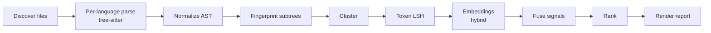

<!-- agent-pmo:b636503 -->
# Deslop Live — Agent Instructions

Deslop is a duplicate-code detector. **We are in accuracy-audit mode.** One measure outranks everything else — not features, not languages, not UI, not performance:

> **Every reported cluster is a real duplicate, and every real duplicate is reported.** And, the reported figures like percentages are **transparent, accurate** calculations 

## Accuracy quarantine — tests outrank code

**A failing test that pins a bug is worth more than code that might produce a false positive or false negative.** Code you *believe* is correct is a liability until an assertion proves it. A red test in the tree is a correct outcome; weakening it is not.

When you find code that could cause a false positive or false negative, whether or not you were sent to change it:

1. 🛑 **STOP** the current task.
2. **Delete the defective code** and replace it with a `panic!` documenting what the code did and why it was removed. Allow the `panic = "deny"` lint on that line only.
3. **Write a test that fails because the code is missing.** Assert the cluster, occurrence count, file paths, bucket and ranking order; a test that would pass if the detector went blind asserts nothing.
4. **Tell the user:** the file, the defect, the failing test, and what you removed.

**Next step:** replace the panic with a **fresh, real implementation** that turns the test green. Do **not** start until the user acknowledges. Never patch or work around the deleted code.

Panics are banned for control flow and error handling but **mandated** here: a panic is found in seconds, a silent false negative never is.

## Rules

### Invariants

- 🛑 **Never kill a VS Code process**, including browser-hosted instances. The user cannot recover.
- 🛑 **Never host a report.** No artifacts, hosted pages or uploads. Every report is a Markdown file in this repo, emitted **mechanically** by the code that ran the measurement; agent-typed figures can't be reproduced or diffed. Point the user at the file path.
- 🛑 **One branch, one worktree.** Merge loose code, stashes and branches into a ***single*** branch.
- **Clean up after yourself.** Delete every temporary file you write.
- **Tree-sitter only.** **No regex** or text matching on source code or structured data.
- **Core calculations (e.g. percentages) live only in Rust.** Any duplication-finding calculation outside core Rust (e.g. in TypeScript) is a hard violation. Scripts and utilities are exempt.
- **Files < 500 lines, functions < 20 lines.**
- **Named constants, not literals**, in tests too. Every threshold is a named default the user can override in config.
- **Spec IDs, not issue numbers.** IDs are hierarchical and non-numeric (`[GROUP-TOPIC]`, `[GROUP-TOPIC-DETAIL]`) and appear in spec, code and test comments, so `grep [RANK-` finds all three. Same-group sections sit adjacent. Only explicit regression tests may cite a GitHub issue.
- **No placeholders, silent no-ops, legacy code or linter suppressions** (`#[allow(clippy::...)]`). Use proper error types; fix the code.
- **All global state lives in `crates/deslop-core/src/state.rs`**, with one equivalent file per other language.
- **Bug fixes follow the [fix-bug skill](.claude/skills/fix-bug/SKILL.md).** Fix the root cause; replace broken code, **never** add a duplicate path beside it.
- **Dependency versions stay in sync** across `Cargo.toml`, `.github/workflows/ci.yml` and `.devcontainer/`.
- **Auto-memory is off.** Durable rules are reviewed changes to this file.
- **IPC wire models are generated from [typeDiagram](https://typediagram.dev/docs/language-reference.html)**, never hand-written or committed.
- **The VSIX is the only distribution**, plus Homebrew/Scoop for the CLI. Build output stays under `target/`; **never** `cargo install --path crates/deslop-*`.
- **Docs point external MCP clients at the absolute VSIX path** `~/.vscode/extensions/nimblesite.deslop-live-<VERSION>-<platform>/bin/<platform>/deslop-mcp` (or the Windows equivalent); a `PATH` binary drifts off the wire contract. Bare `deslop-mcp` is for Homebrew/Scoop only.
- **Logging is `tracing` only**, never `println!`/`eprintln!`. Use structured fields (`tracing::info!(file_count = 42)`) and log entry and exit of significant operations. Log counts and hashes, **never** file contents, user paths or secrets. Reports go to stdout or `--output <path>`, not logs.
- **"Deslop.live" means the whole reactive loop:** watcher → scheduler → session → broadcast → UI refresh.

### Strongly Recommended

- **Act autonomously.** Do not stop for confirmation — except where the accuracy quarantine says STOP. Record assumptions and continue.
- **Aggressively DRY.** This tool detects duplication; its own codebase must be exemplary. Use deslop itself to prevent duplication and check the current state routinely
- **A+ quality bar.** Every change must pass review at a top-tier engineering org. Fix substandard code immediately; never defer it.
- **Token discipline.** Check file size before reading. `Grep` over `Read`; use `offset`/`limit`. Make the smallest diff that solves the problem. Delete dead code, unused imports and stale comments. Call out irrelevant context; bloat degrades reasoning.
- **Headlines only.** Chat replies are a status line: the result, the number that moved, the file path. Don't restate the request, narrate steps, or repeat tables the report already contains. Mark anything critical so it's findable at a glance: 🛑 a blocker, 🔴 a regression or failing gate, ✅ a pass.
- **Use Too Many Cooks** for file locking and agent messaging when it is available.
- Don't close GitHub issues, even from PRs, unless the user asks.

## Testing — the accuracy enforcement surface

- Organise tests in to logical folders and logical files within those folders. Don't just dump tests in crates/deslop/tests and name the file after the issue name. Group them together logically
- **Coarse E2E, black-box only.** Drive the CLI against fixture repos; assert against rendered reports. Never reach into internals.
- **Many user interactions per test, many assertions per user interaction.**
- **Every confirmed false positive or false negative earns a fixture** that would have caught it.
- **Never back off a test.** Never delete a failing test, skip one, or remove an assertion. Reducing assertiveness is prohibited. Add failing tests for broken or missing functionality.
- **Avoid explicit regression test names or file names.** Put regression tests in logical groupings with other tests, but you can subtly mention the gh issue number
- **Unit tests are only for isolating behavior of functions**
- **Meaningful assertions only.** `assert!(true)` is banned. Assert positive, human-readable values — not the absence of AI-style labels.
- **No try/catch that swallows an error and then asserts success.**
- **No fake LSP/MCP.** UI and extension tests build and install the latest binaries first.
- **`make test` is fail-fast** and always enforces coverage. Never `--no-fail-fast`. Target 100% coverage and a high mutation score.
- **Deterministic.** No `sleep`, no timing dependencies, no random state.
- **Coverage thresholds live in `coverage-thresholds.json`** at the repo root — never env vars, GitHub variables, or CI YAML. Monotonic increase only (−1% rounding allowance); falling below fails the pipeline.

## Version comparison — the corpus run

"Compare to version X" means **only** `scripts/compare-versions.sh <X> HEAD` ([CORPUS-SCORE-COMPARE]): both builds are scored against the known answers in `corpus/register/`. The script writes the scorecard `compare-<UTC timestamp>.md` (plus `.json` twin, [CORPUS-REPORT]), `INDEX.md` and per-repo `SUMMARY.md` under `.corpus/version-compare/reports/`. Point the user at those files. **Never** substitute an LLM, subagent or code review.

## Rust

- No `unwrap()`/`expect()` in production code; tests may `expect` with a message.
- No `panic!`/`todo!`/`unimplemented!`/`unreachable!` for control flow or error handling — return `Result<T, E>`; a panic there is a bug. Mandated only for the accuracy quarantine above.
- No `unsafe {}` (`unsafe_code = "deny"`). All public items carry `///` docs (`missing_docs = "deny"`).
- `thiserror` in `deslop-core`; `anyhow` allowed in the `deslop` binary.
- Pattern matching over casting. Expressions over statements. Iterator chains over imperative loops. Early return with `?`.
- Descriptive names — no single letters except in closures.

## Documentation

- **Always cross-reference spec IDs across tests, code, specs and plans.**
- Each spec section has a unique, hierarchical, non-numeric spec ID.
- Code, specs and tests must agree. Where they don't, STOP and report the issue to the user.
- Specs are for humans first: keep jargon out of the main text and put it in a separate "For AI" section.
- Remove fluff from specs that doesn't specify anything.
- Keep PR documentation tight and human-readable (except for the AI section).
- Don't use line breaks to force word wrap; let text wrap naturally.

## Architecture

Every stage can lose accuracy. Normalization that strips too much manufactures false positives; too little manufactures false negatives. Ranking changes change every report — they need new assertions, not adjusted ones.

**Build:** `make ci` · **Test:** `make test` · **Lint:** `make lint`. There are 7 AgentPMO make targets; repo-specific targets sit below a horizontal marker. Debug one test with `cargo test <name> -- --nocapture` — not a Makefile target.

Paths, pipeline-stage detail, and the `lspkit` migration map live in [docs/repo-index.md](docs/repo-index.md) — read it only when you need to locate something.

## UI and audience

- VSIX first; IntelliJ and other plugins in progress. Consistency across panels is critical.
- **Never duplicate the rendering of text or links** (clusters, occurrences). One shared function, reused everywhere.
- Context menus always include "Copy Context For AI".
- Humans first for code comments, UI, and HTML reports. Raw JSON reports target AI — complete enough to reconstruct the human view.