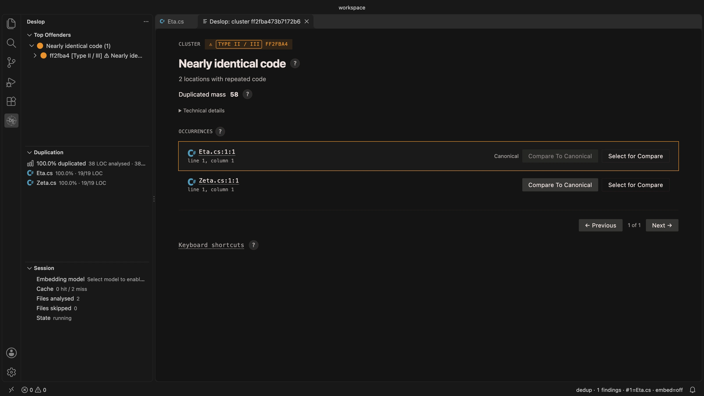

# Deslop

**Clean up the duplicate code in your repo, and stop your coding agents from writing more.**

Deslop finds duplicate code across a codebase and ranks it worst first, so the cleanup that matters most comes first. While you or Claude Code, Cursor or GitHub Copilot edit, it flags new code that copies something that already exists. It is an open-source alternative to jscpd that also runs live in the editor and inside the agent loop.

[Install for VS Code](https://marketplace.visualstudio.com/items?itemName=nimblesite.deslop-live) ·
[Add to GitHub Actions](https://deslop.live/docs/github-action/) ·
[Supported languages](https://deslop.live/#languages) ·
[Documentation](https://deslop.live/docs/)

[](https://deslop.live/docs/vscode-cluster-panel/)

## Clean up what's there

- **VS Code:** install from the [Marketplace](https://marketplace.visualstudio.com/items?itemName=nimblesite.deslop-live) and open your repo. Top Offenders lists the clusters to remove, and each copy can be diffed against the canonical one before you refactor.
- **JetBrains:** install the plugin zip from the [latest release](https://github.com/Nimblesite/Deslop/releases/latest) from disk, with [LSP4IJ](https://plugins.jetbrains.com/plugin/23257-lsp4ij). It is not on the JetBrains Marketplace yet.
- **CLI:** `brew install nimblesite/tap/deslop`, or on Windows `scoop bucket add nimblesite https://github.com/Nimblesite/scoop-bucket` then `scoop install deslop`. For a [checksum-verified `curl` install](https://deslop.live/docs/#macos--linux-curl), see the docs.

```bash
deslop                         # scan the current directory
deslop . --output ./report     # write report.json, report.txt, report.html
```

Configuration lives in `.deslop.toml` ([reference](https://deslop.live/docs/configuration/)).

## Stop new duplicates

**Coding agents.** The VS Code extension bundles `deslop-mcp`. Point your agent at it, then add the [Deslop agent instruction](docs/snippets/agents-md-recipe.md) to your repo so the agent calls `find-similar` before writing a function, helper or test setup. Setup for each client: [AI integration](https://deslop.live/docs/ai-integration/).

**CI.** Fail the build when duplication goes over a ceiling:

```yaml
- uses: actions/checkout@v4
- uses: Nimblesite/Deslop@vX.Y.Z   # the newest release tag
  with:
    fail-over: "5.0"               # fail above 5% duplicated lines
```

Anywhere else, run `deslop . --fail-over 5.0`. It exits with code `3` when the ceiling is breached and still writes the reports. For pre-commit or prek, install the CLI and add:

```yaml
repos:
  - repo: https://github.com/Nimblesite/Deslop
    rev: vX.Y.Z
    hooks:
      - id: deslop
        args: ["--fail-over", "5.0"]
```

## How it compares

Deslop parses code with tree-sitter and compares syntax trees, not token streams. That lets it report copies with renamed identifiers, changed literals or inserted statements as well as exact ones. Optional local embeddings through Ollama add copies that behave the same but read differently.

Accuracy is checked against [judged clone registers](corpus/register/): pairs from pinned open-source repositories that a reviewer has marked as real copies or not copies. [Accuracy Transparency](https://deslop.live/docs/accuracy-transparency/) explains the scoring. No head-to-head benchmark against jscpd or other detectors has been published, so we make no claim that Deslop is more accurate than they are.

## Developing Deslop

The engine is a Rust workspace under `crates/`. The VS Code client is in `clients/vscode/` and the JetBrains client in `clients/jetbrains/`.

```bash
make ci      # build, lint and test everything, as CI does
make test    # fail-fast tests with coverage thresholds
make lint    # format and static analysis
```

- Accuracy outranks features, languages, UI and performance. Read [AGENTS.md](AGENTS.md) before changing detection code.
- Specs live in [docs/specs/](docs/specs/SPEC.md) and the code map in [docs/repo-index.md](docs/repo-index.md).
- The most useful contribution is a bug report with a reproduction, especially for inaccurate results. Code contributions are restricted while we audit for accuracy: see [CONTRIBUTING.md](CONTRIBUTING.md).

## License

[MIT](LICENSE) © NIMBLESITE PTY LTD.
